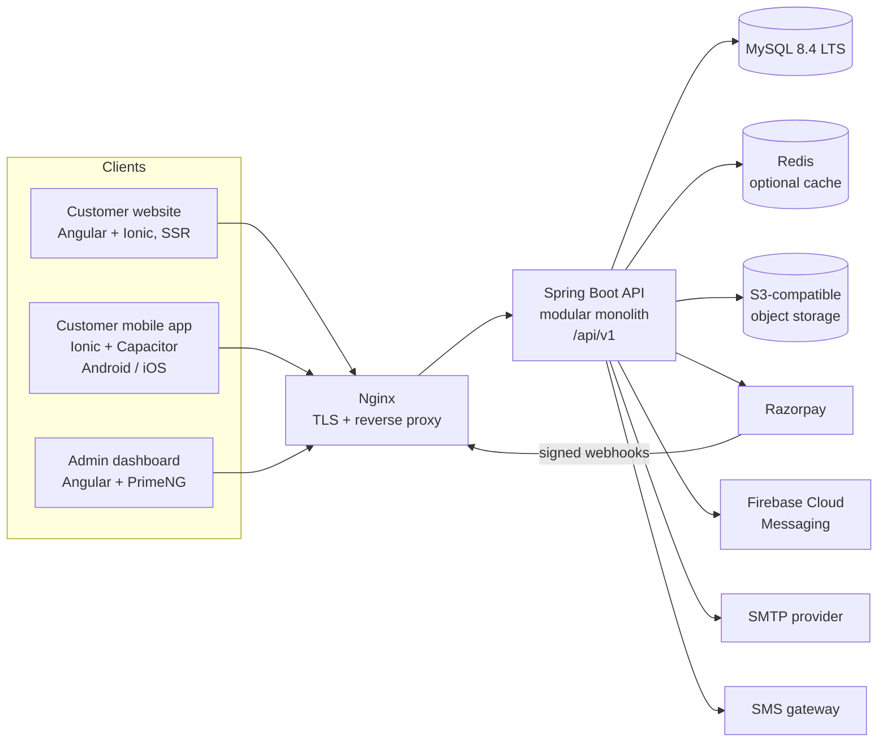
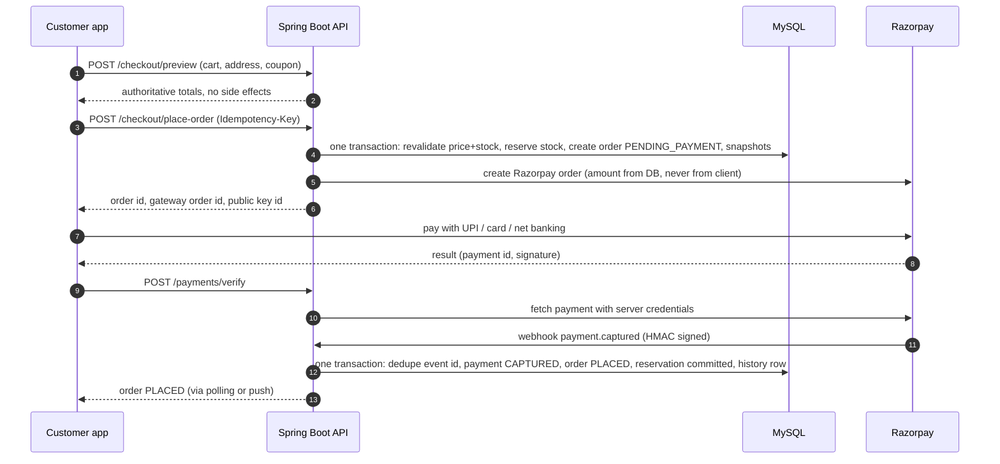
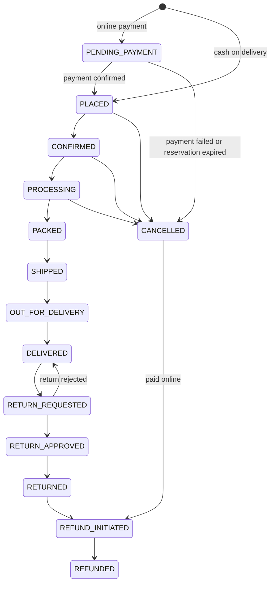
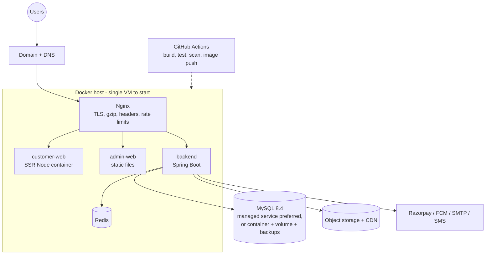

# ShopyHapy – Architecture

Status: **Stage 0 – proposed, awaiting approval** · Last updated: 2026-11-11

Version numbers are justified, with evidence, in `TECHNICAL_DECISIONS.md`. Items marked **(decision needed)** are choices I am
proposing but want you to confirm.

## 1. System context



The three front-ends never talk to MySQL, storage credentials or payment secrets. Everything sensitive lives behind the API.

## 2. Backend – modular monolith

One Spring Boot application, one deployable, one database. Modules are packages by **feature**, not by technical layer:

```
com.shopyhapy
  config/ security/ common/ exception/        cross-cutting
  authentication/ user/ address/              identity
  category/ brand/ product/ inventory/        catalogue
  cart/ wishlist/ coupon/ checkout/           buying
  order/ payment/ refund/ shipping/           fulfilment & money
  review/ notification/ report/ audit/        supporting
```

Inside every module:

```
<module>/
  api/        controllers + request/response DTOs        (thin; no business logic)
  service/    use-case services, @Transactional          (the module's public surface)
  domain/     entities, value objects, state machines
  repository/ Spring Data repositories                   (package-private to the module)
```

**Boundary rules (enforced by automated architecture tests):**

1. Controllers call only their own module's services.
2. A module never touches another module's repositories or entities; it calls that module's public service interface, or
   listens to an application event.
3. Entities are never returned from controllers; DTOs only.
4. Cross-module writes that must be atomic (checkout) go through one orchestrating service (`checkout`) inside one transaction.
5. Side effects that need not be atomic (emails, push notifications, audit logs) are published as events and handled
   after commit.

This keeps the option of extracting a module later without paying the microservice cost now.

### Cross-cutting concerns

| Concern | Design |
|---|---|
| Response format | Envelope from the spec: `success, message, data, timestamp, errors[]`; one `@RestControllerAdvice` produces all errors |
| Validation | Bean Validation on DTOs; business-rule violations raised as typed exceptions with stable error codes |
| Pagination | `page, size, sort, direction`; list responses return `items, page, size, totalElements, totalPages`; `size` capped server-side; sort fields allow-listed |
| Security | Stateless JWT; method-level authorization with permission codes; admin routes under `/api/v1/admin/**` require admin permissions **on the server** |
| Idempotency | `Idempotency-Key` header on `checkout/place-order` and `payments/create-order`; keys stored with the resulting resource |
| Audit | Admin mutations write `admin_audit_logs` (old/new JSON, IP) after commit |
| Time & money | UTC timestamps; `DECIMAL(12,2)` and `BigDecimal` only; one central rounding policy |
| Observability | Actuator health/info/metrics, structured JSON logs with a request/correlation id, no PII or secrets in logs |
| Config | Spring profiles (`local`, `test`, `staging`, `prod`); secrets only from environment variables |

## 3. Security architecture

| Area | Approach |
|---|---|
| Passwords | BCrypt (cost 12) – no extra dependency; hashes only, never logged |
| Access token | JWT, ~15 min, carries user id, roles, permissions |
| Refresh token | Opaque random value, stored **hashed**, rotated on every use; reuse of a rotated token revokes the whole family; logout revokes |
| Web vs native token storage **(decision needed)** | Web: refresh token in `HttpOnly; Secure; SameSite` cookie. Native: secure-storage plugin. Backend supports both |
| OTP | 6 digits, stored hashed, short expiry, attempt limit, resend cooldown; delivered through an `OtpSender` interface (email now, SMS gateway when chosen) |
| Rate limiting | On login, OTP, forgot/reset-password, coupon validation, search and webhook endpoints |
| Authorization | Role → permission codes; ownership check on every customer resource (cart, address, order, wishlist) to prevent IDOR |
| Input handling | Parameterised queries only (JPA); output encoding by Angular; sanitised rich-text descriptions; strict CORS allow-list; security headers via Nginx and Spring |
| Uploads | Size and count limits, content-type sniffing (not just file extension), re-encoded images, random object keys, never served from the app's filesystem |
| Payments | Razorpay Standard Checkout so card data never touches our servers; webhook HMAC verified on the **raw body**; secrets in env only |
| Privacy | Minimal PII, deactivation flow, data-export/erasure hooks designed for India's DPDP Act obligations (confirm requirements with legal counsel) |

## 4. Customer application (Ionic + Angular + Capacitor)

One codebase, two build targets:

| Target | Output | Purpose |
|---|---|---|
| `web` | Angular application builder with server-side rendering/prerendering | Public website, SEO, social sharing |
| `native` | Client-side static bundle | Packaged by Capacitor into the Android/iOS apps |

```
customer-app/src/app/
  core/       auth, guards, interceptors, services, models, constants
  shared/     components, directives, pipes, utilities
  features/   onboarding, authentication, home, categories, products, search,
              wishlist, cart, checkout, addresses, payments, orders, profile, notifications
  layout/     shell, bottom tabs (mobile), header/footer (desktop)
  app.routes.ts  app.config.ts
```

- Angular **standalone components only**, strict TypeScript, no `any` without justification, lazy-loaded feature routes.
- **State:** Angular signals for local/shared UI state; RxJS for HTTP and async streams. No NgRx or other state library.
- **HTTP:** typed API services; interceptors for auth header, silent refresh (single-flight), error mapping, correlation id.
- **Design tokens:** SCSS/CSS custom properties for colour, spacing, radius, elevation, typography; no hex colours in components.
  Palette per spec: deep navy primary, orange accent, neutral greys, semantic success/warning/error. Locally hosted font.
- **Responsive:** bottom tab bar (Home, Categories, Wishlist, Cart, Account) on phones; top navigation, product grids and a
  two-column cart/checkout on desktop.
- **Guest cart:** held server-side against a `session_id` (so it survives reinstalls of the web page) and merged into the
  user's cart at login with variant/stock validation.
- **Known risk – Ionic + SSR:** Ionic components are web components; server rendering and hydration of public pages has
  caveats. Mitigation: a time-boxed spike in Stage 5 on a product page; keep public catalogue pages lightweight; fall back to
  prerendering for static routes if full SSR proves unstable. SEO is verified, not assumed (Stage 11).

## 5. Admin application (Angular + PrimeNG)

Separate project, same conventions (`core/ shared/ layout/ features/`). PrimeNG tables with server-side pagination, sorting and
filtering, Chart.js dashboards, reactive forms, permission-aware route guards **and** menu visibility (the real enforcement is
the backend). Confirmation dialogs on every destructive action; optimistic UI is avoided for stock and money.

API types: the backend publishes OpenAPI; both front-ends should generate their DTO types from it so contracts cannot drift
**(decision needed – see TD-09)**.

## 6. Core flows

### 6.1 Checkout and payment (online)



Rules that follow from this:

- The order is never marked paid because the **client** said so. `verify` checks the signature *and* confirms with Razorpay; the
  webhook is the authoritative backstop. Whichever arrives first wins; the other is an idempotent no-op.
- `place-order` with the same `Idempotency-Key` returns the same order – a double-tap or network retry cannot create two.
- A scheduled **reconciliation job** polls Razorpay for payments stuck in `PENDING` past a threshold.
- A scheduled **reservation-expiry job** releases stock for unpaid orders after the reservation window (default 15 min) and
  moves them to `CANCELLED`.
- COD skips the payment steps: the order goes straight to `PLACED` with `payment_status = COD_PENDING`.

### 6.2 Inventory reservation

- `inventory.available_quantity` and `reserved_quantity` per variant (or per product when it has no variants).
- Reserve with a single atomic conditional `UPDATE … SET reserved = reserved + :q WHERE available - reserved >= :q`; zero rows
  updated means insufficient stock. Multi-item orders lock rows in a **deterministic order** to avoid deadlocks.
- Every change writes an `inventory_transactions` row (reserve, release, commit, adjustment, return).
- Negative stock is impossible by construction and by a database `CHECK` constraint.

### 6.3 Order status workflow (proposed – to be finalised in Stage 1)

The spec defines `PLACED → … → DELIVERED` plus cancellation/return/refund states. One addition is proposed:
`PENDING_PAYMENT` for online orders that exist but are not yet paid. **(decision needed)** Without it, an unpaid order would
have to sit in `PLACED`, which would wrongly tell the business that a sale is committed.



Transitions are implemented once, as a state-machine class in `order/domain`, with a unit test that checks every allowed **and**
every forbidden pair. Each transition writes `order_status_history` and may emit notifications and inventory movements.

## 7. Data architecture

MySQL 8.4 LTS, InnoDB, `utf8mb4`, Flyway-managed schema, `BIGINT` identity keys **(decision needed – TD-08)**, `DECIMAL` money,
UTC timestamps, foreign keys everywhere, soft deletion for catalogue/business records, immutable order snapshots (product, variant,
price, tax, address). Orders, payments, refunds and history are **never physically deleted**. The full ER model, indexes and
migrations are the Stage 1 deliverable; the tables listed in your spec are the starting point.

Search starts with MySQL (`FULLTEXT` + prefix queries for suggestions). A dedicated search engine is deliberately deferred until
measured load justifies it. Redis (optional) caches home sections, category tree and settings.

## 8. Deployment architecture



- **Environments:** `local` (Docker Compose), `staging`, `prod`. Same images, different environment variables.
- **Migrations:** Flyway runs at backend start (or as a one-shot job); applied migrations are never edited.
- **Secrets:** environment variables / Docker secrets, never in Git. A `.env.example` documents every variable with no values.
- **Operations:** health checks per container, JSON logs, scheduled MySQL backups with a tested restore procedure, uptime and
  error monitoring (provider chosen in Stage 15; needs your account).
- **Mobile releases:** Android AAB and iOS archive prepared in Stage 15; nothing is published to a store without your approval.

## 9. Roadmap view

Stages 1–4 build the data model and backend; 5–8 deliver the shopping experience; 9–10 make money and orders real; 11–12 finish the
web and admin; 13 adds notifications; 14 is hard verification; 15 is production readiness. Details, exit criteria and where each
stage can actually be executed are in `DEVELOPMENT_PLAN.md`.
